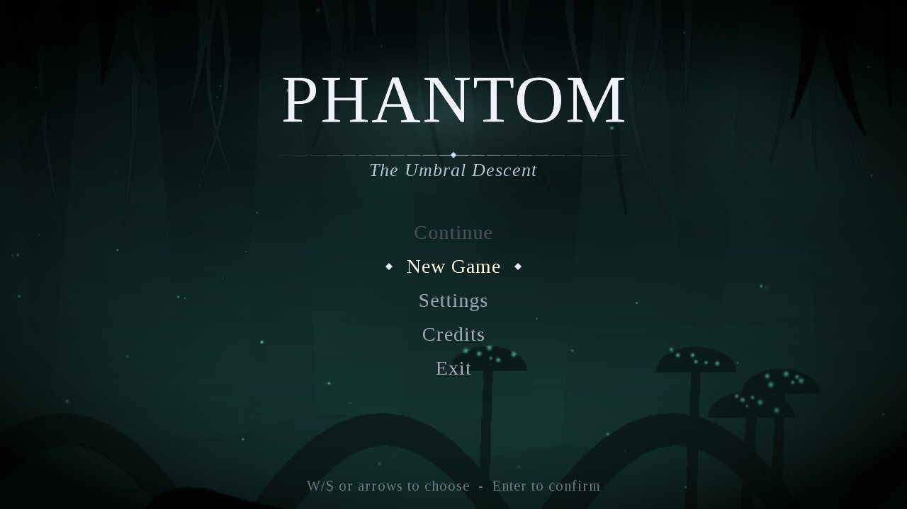
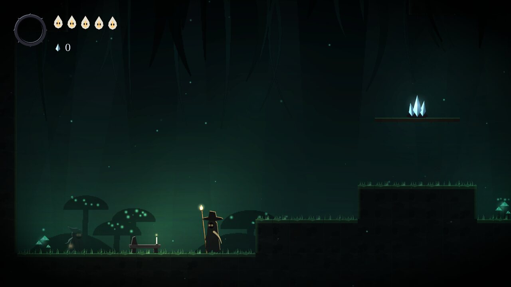
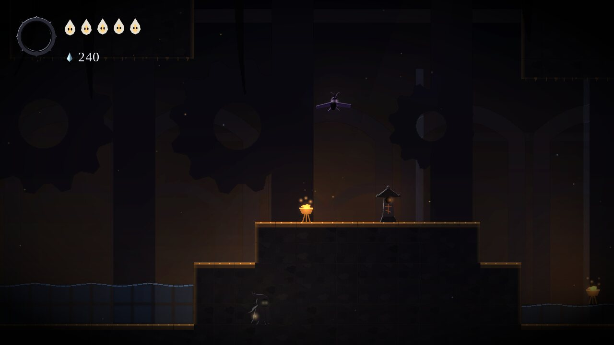
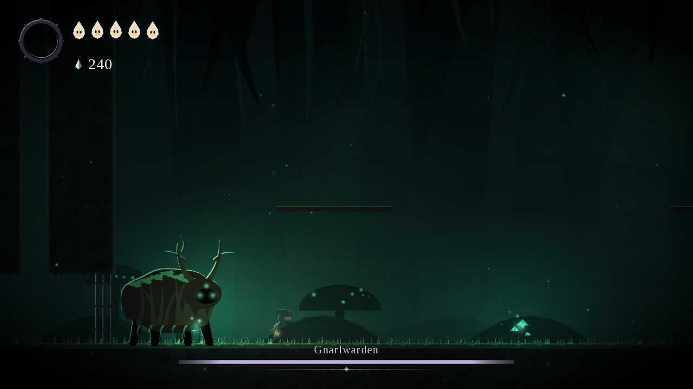
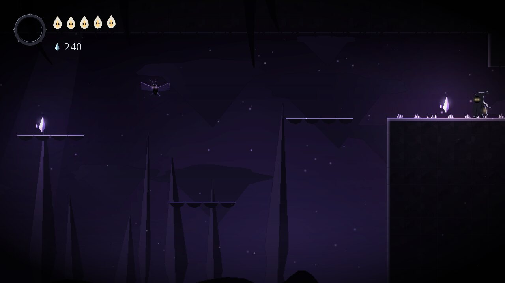
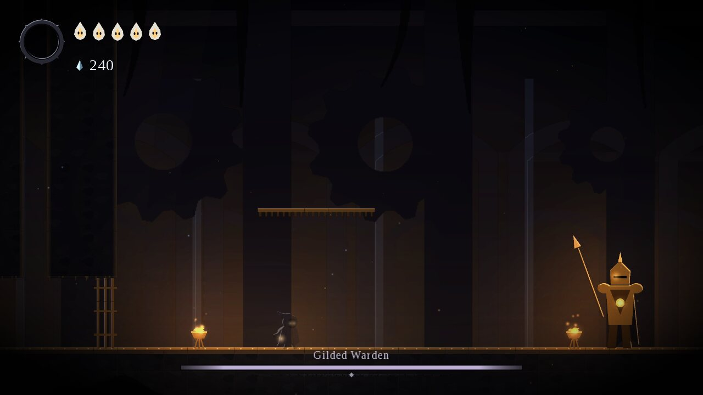
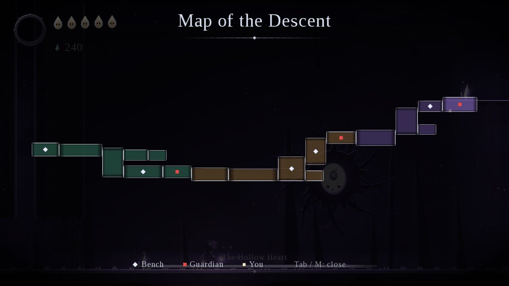

# PHANTOM: The Umbral Descent

A 2D metroidvania in Java 17 and libGDX, built as a college object-oriented programming
project. You play **Phantom**, a cloaked wanderer with a lantern-blade, descending through
three connected regions beneath the dead city of Veyra, regaining lost abilities, defeating
three guardians and choosing how the story ends.

Every sprite, background and sound is **generated by code at startup**. There are no image or
audio files in the repository.



| | |
|---|---|
|  |  |
|  |  |
|  |  |

## Features

**Movement and combat.** Running with acceleration and friction, variable-height jumps, coyote
time and jump buffering. A lantern-blade slash forward, up and down; down-slashing an enemy or
spikes bounces you (pogo). Knockback, hit-stop and screen shake on hits, invincibility frames
after taking damage. Light energy from hits powers **Focus** (hold to heal) and the **Light Bolt**.

**Abilities that open the map.** Umbral Dash (reward for the first boss), Moss Grip wall cling
and wall jump (shrine in the Drowned Chapel), Wisp Leap double jump (reward for the second
boss), plus the Light Bolt shrine in Region 1.

**World.** 18 rooms across *Whispering Roots* (teal moss caves), *Gilded Cistern* (flooded brass
ruins) and *The Umbral Heart* (violet void). Benches save and heal, and there are breakable
walls with three secret rooms, spikes, falling rocks, Hollow Mist pools, one-way ledges, a map
that fills in as you explore, a shopkeeper, three lore NPCs and shard caches.

**Enemies and bosses.** Mosscrawler, Duskmoth, Lantern Sentinel and Husk Brute, each driven by
its own state machine. Three multi-phase bosses with telegraphed attacks, health bars and
locking arenas: the **Gnarlwarden**, the **Gilded Warden** and the **Hollow Heart**.

**Story.** Dying leaves a shade holding your shards; touch it to get them back. The game tracks
abilities, boss defeats, relics, deaths and play time, and has two endings plus a hidden third
one if you find all three Ember Relics.

**Presentation.** Four parallax layers per region with fog between them, a multiplied light
map with additive glows, light shafts, drifting ground mist, spores, embers, ash and drips,
water ripples, a smooth look-ahead camera, a vignette, a serif title screen with an animated
background, and synthesised sound effects and ambient drones.

**Saving.** JSON save in `~/.phantom-descent/`. Missing, corrupted or incompatible saves never
crash the game: you get a message and a fresh start, and the bad file is kept as `save.json.bad`.

## Requirements

* **JDK 17 or newer** (tested with OpenJDK 21). Nothing else: the Gradle wrapper downloads
  Gradle and libGDX on first build (internet needed once).
* A graphics card or driver with OpenGL 2.0+.

## Run from the command line

```bash
./gradlew desktop:run          # Windows: gradlew.bat desktop:run
./gradlew test                 # run the JUnit suite (72 tests)
./gradlew build                # compile everything and run the tests
./gradlew desktop:dist         # runnable fat jar in desktop/build/libs/
./gradlew sourceZip            # source + docs ZIP in build/distributions/
```

## Import into Eclipse

1. Install a **JDK 17+** and make sure Eclipse uses it
   (*Window > Preferences > Java > Installed JREs*).
2. *File > Import... > Gradle > Existing Gradle Project*, choose this folder, then *Finish*.
   Buildship comes with "Eclipse IDE for Java Developers". Eclipse shows three projects:
   `PhantomDescent`, `PhantomTheUmbralDescent-core` and `PhantomTheUmbralDescent-desktop`.
3. Run the game: open `desktop/src/main/java/phantom/desktop/DesktopLauncher.java` and choose
   *Run As > Java Application*. The `assets` folder is also on the desktop classpath, so the
   game finds its rooms and fonts whatever the working directory is.
4. Run the tests: right-click `core/src/test/java` and choose *Run As > JUnit Test*.

If anything goes wrong, see [docs/TROUBLESHOOTING.md](docs/TROUBLESHOOTING.md).

## Controls (keyboard)

| Action | Keys |
| --- | --- |
| Move | A / D or Left / Right |
| Jump (hold for higher) | Space or Z |
| Strike (hold W or S to aim up or down) | J or X |
| Dash | K, C or Left Shift |
| Light Bolt | L or Q |
| Focus (hold) | F or V |
| Interact / look up | W or Up |
| Drop through a ledge | S + Jump |
| Map | Tab or M |
| Pause | Esc or P |

Gamepads work too. See [docs/CONTROLS.md](docs/CONTROLS.md).

## Project structure

```
PhantomPunk/
├── build.gradle, settings.gradle, gradle.properties, gradlew, gradlew.bat
├── assets/                     rooms/*.json, fonts/, README.md, LICENSES.md
├── core/src/main/java/phantom/
│   ├── PhantomGame.java        entry point, fixed-timestep loop, shared services
│   ├── abilities/              Ability (interface) + Dash, WallCling, DoubleJump, LightBolt, Focus
│   ├── ai/                     StateMachine<E>, EnemyState, EnemyBehaviour, Behaviours
│   ├── art/                    Canvas rasteriser, painters, SpriteFactory, ParallaxBackground
│   ├── audio/                  SoundSynth (PCM synthesis), AudioManager
│   ├── components/             HealthComponent, Inventory, AbilitySet, Animator, Hitbox, SoulMeter
│   ├── entities/               GameObject > Entity > Character, Projectile, Shade, interfaces
│   │   ├── player/             Player, PlayerMotor, PlayerAttack, PlayerView
│   │   ├── enemies/            Enemy, Crawler, Flutterer, Sentinel, Brute
│   │   ├── bosses/             Boss, BossAttack strategies, Gnarlwarden, GildedWarden, HollowHeart
│   │   └── props/              Bench, NPCs, Shopkeeper, shrines, breakables, hazards
│   ├── events/                 EventBus, Events (records)
│   ├── input/                  InputSource, KeyboardInput, ScriptedInput
│   ├── render/                 WorldRenderer, TileRenderer, RenderContext, Fonts
│   ├── save/                   SaveManager, SaveData, Settings, SaveException, Saveable
│   ├── screens/                ScreenManager stack + Title, Game, Pause, Map, Dialogue, Death...
│   ├── story/                  LoreLibrary, Ending, EndingDirector
│   ├── systems/                CollisionSystem, CombatSystem, CameraController, LightingSystem,
│   │                           ParticleSystem, Effects, AchievementTracker
│   ├── ui/                     Hud, MapRenderer, DialogueBox, Menu, UiKit
│   ├── util/                   Constants, ObjectPool<T>, Direction, GameMath
│   └── world/                  GameWorld, Room, TileMap, RoomLoader, EnemyFactory, GameProgress...
│       └── validation/         LevelValidator, MovementModel, RoomReachability
├── core/src/test/java/phantom/ JUnit 5 tests (physics, combat, AI, saves, levels, simulation)
├── desktop/src/main/java/phantom/desktop/   DesktopLauncher, StartupHelper, ScreenshotTour
└── docs/                       PLAN, DESIGN, OOP_VIVA_GUIDE, CONTROLS, TROUBLESHOOTING, TEST_REPORT
```

## Documentation

* [docs/OOP_VIVA_GUIDE.md](docs/OOP_VIVA_GUIDE.md): every OOP concept, where it is used, likely viva questions, class diagram, game loop
* [docs/DESIGN.md](docs/DESIGN.md): architecture and design decisions
* [docs/CONTROLS.md](docs/CONTROLS.md): keyboard and gamepad
* [docs/TROUBLESHOOTING.md](docs/TROUBLESHOOTING.md): Eclipse and Gradle problems
* [docs/TEST_REPORT.md](docs/TEST_REPORT.md): what was tested and the actual results
* [docs/PLAN.md](docs/PLAN.md): milestones and world layout
* [assets/README.md](assets/README.md): how the procedural art works and how to replace it

## Developer tools

```bash
./gradlew :core:artPreview -PoutDir=/tmp/art   # PNG contact sheets of all procedural art (no GPU needed)
./gradlew desktop:tour -PoutDir=/tmp/shots     # scripted run through the game that saves screenshots
```

## Known limitations

* Room-to-room travel is only through left and right doors; vertical travel happens inside tall rooms.
* The level validator uses a conservative movement model. The real physics of every ability gate
  is checked separately by scripted traversal tests (see the test report).
* Gamepad support uses the standard SDL mapping; buttons cannot be remapped in-game.
* Audio is synthesised and simple; there is no music beyond the ambient drones.
* Under a software OpenGL renderer the game runs well below 60 FPS (see the test report).
  On a normal GPU, rendering is light.

## Licence notes

Code: written for this project. Font: Liberation Serif, SIL Open Font License 1.1
(`assets/fonts/OFL.txt`). Libraries: libGDX (Apache 2.0). See `assets/LICENSES.md`.
