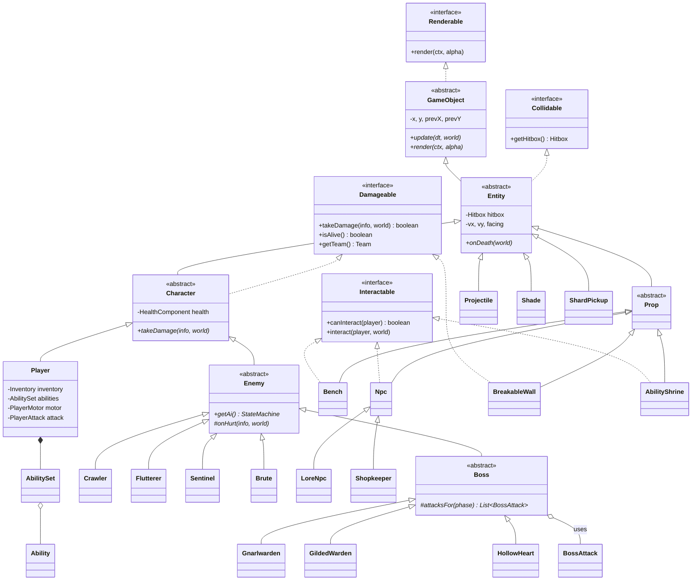
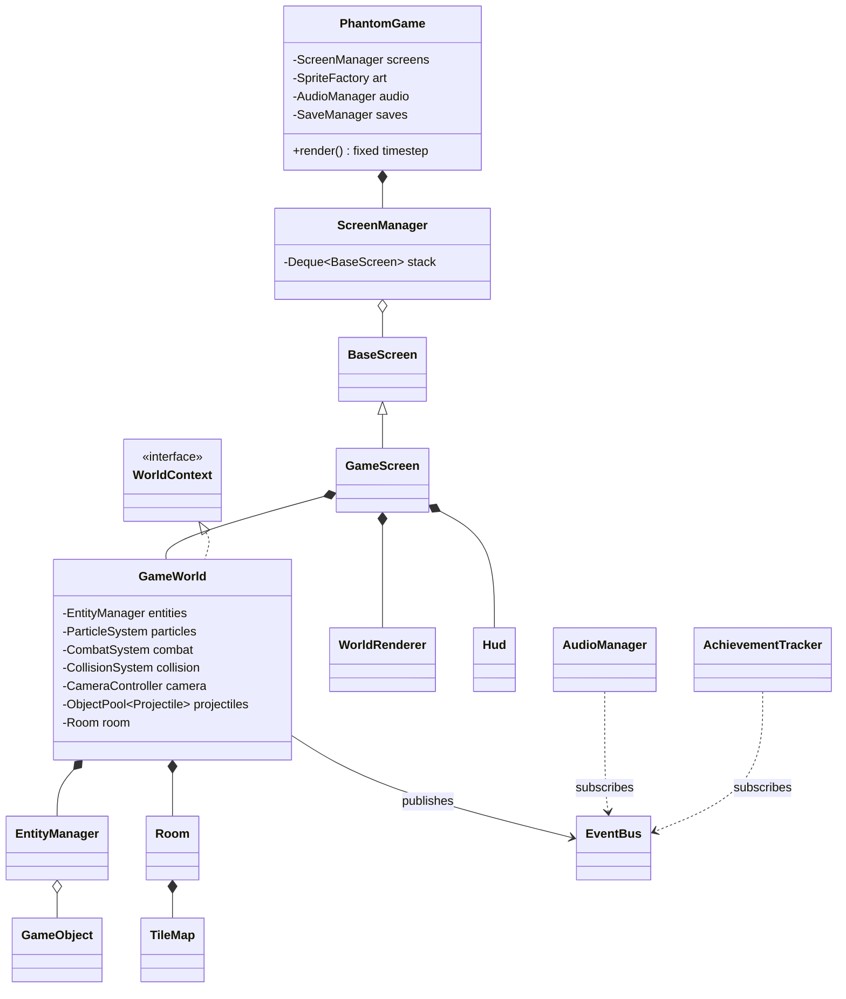

# OOP Viva Guide

For each concept: **where** it is in the code, **what** it does there (2 to 3 lines), and a
**likely viva question** with a short answer. File paths are under
`core/src/main/java/phantom/` unless stated otherwise.

---

## 1. Encapsulation

**Where:** `components/HealthComponent.java`, `components/Inventory.java`, `world/TileMap.java`,
`save/SaveData.java`, `entities/GameObject.java`.

**What:** Fields are `private`. Other classes change state only through methods that keep the
object valid: `health.damage(amount, iframes)` refuses damage while invincible,
`inventory.spendShards(n)` refuses to go negative, `TileMap.get(c, r)` treats out-of-bounds as
solid. There are no public mutable fields in the project.

> **Q: Why not just make `health` public?**
> A: Then any class could set it to -50 or skip the invincibility rule. With `damage()` the rule
> lives in one place, so the player, enemies and bosses all behave correctly.

---

## 2. Inheritance

**Where:** `entities/GameObject.java` → `entities/Entity.java` → `entities/Character.java` →
`entities/player/Player.java` and `entities/enemies/Enemy.java` → `Crawler`, `Flutterer`,
`Sentinel`, `Brute` and `entities/bosses/Boss.java` → `Gnarlwarden`, `GildedWarden`, `HollowHeart`.

**What:** Each level adds one responsibility. `GameObject` has position and interpolation;
`Entity` adds size, velocity and tile collision; `Character` adds health, hit flash and
knockback; `Enemy` adds AI, contact damage and shard drops; `Boss` adds phases and attack
selection. Subclasses reuse all of it.

> **Q: What does `Crawler` inherit, and what does it add?**
> A: It inherits movement, collision, health, knockback, death handling and shard drops. It
> adds only its patrol behaviour and its drawing (about 60 lines).

> **Q: Isn't five levels too deep?**
> A: The spec asked for this hierarchy. Most variety comes from composition instead (components,
> abilities, boss attacks), so the deep chain stays small and each level is meaningful.

---

## 3. Abstraction

**Where:** abstract classes `GameObject` (`update`, `render`), `Entity` (`onDeath`), `Character`
(`takeDamage`), `Enemy` (`getAi`, `onHurt`, `getGlowColor`), `Boss` (`attacksFor`,
`reposition`, `cooldownFor`, `isFinal`), `screens/BaseScreen` (`update`, `render`),
`entities/props/Npc` (`interact`, `renderExtras`).

**What:** The abstract class states *what* every subtype must be able to do, and leaves *how*
to the subtype. `GameWorld` and `EntityManager` only know `GameObject`.

> **Q: Why is `Enemy` abstract?**
> A: "An enemy" without behaviour makes no sense. You can only create a concrete kind
> (Crawler, Brute...), and the compiler forces each one to supply its AI and its drawing.

---

## 4. Polymorphism

**Where:** `world/EntityManager.java` (`update` and `render` loops over `List<GameObject>`),
`systems/CombatSystem.java` (hits anything `Damageable`), `components/AbilitySet.java`
(calls `update()` on each `Ability`), `screens/ScreenManager.java` (calls the top screen).

**What:** The same call does different things depending on the real object:
`o.update(dt, world)` runs a crawler's patrol, a projectile's flight or a bench's nothing.
The slash code calls `target.takeDamage(...)`, which on a `BreakableWall` crumbles stone and on a
`Brute` may stagger it.

> **Q: Show me polymorphism in one line.**
> A: `for (GameObject o : objects) o.update(dt, world);` in `EntityManager.update`. The method
> that runs is chosen at runtime (dynamic dispatch).

> **Q: Overloading vs overriding?**
> A: Overriding (runtime polymorphism) is what `Crawler.render` does to `GameObject.render`.
> Overloading is two methods with the same name and different parameters, e.g.
> `RenderContext.sprite(...)` with 5 or 10 parameters (compile-time).

---

## 5. Interfaces

| Interface | File | Implemented by |
| --- | --- | --- |
| `Damageable` | `entities/Damageable.java` | `Character` (player, enemies, bosses), `BreakableWall`, `ShardCache` |
| `Interactable` | `entities/Interactable.java` | `Bench`, `Npc` (`LoreNpc`, `Shopkeeper`), `AbilityShrine` |
| `Collidable` | `entities/Collidable.java` | `Entity` (and so every entity) |
| `Saveable` | `save/Saveable.java` | `Inventory`, `AbilitySet`, `GameProgress` |
| `Renderable` | `entities/Renderable.java` | `GameObject` |
| `Ability` | `abilities/Ability.java` | `Dash`, `WallCling`, `DoubleJump`, `LightBolt`, `Focus` |
| also | `InputSource`, `WorldContext`, `RoomSource`, `SpritePainter`, `SpriteRegistry`, `BossAttack`, `EnemyBehaviour`, `Poolable` | |

**What:** An interface is a contract that unrelated classes can share. A wall and a beetle have
nothing in common in the hierarchy, but both are `Damageable`, so one combat system serves both.
Default methods (`givesSoul()`, `isPogoTarget()`) give sensible behaviour that classes override
only when needed.

> **Q: Abstract class or interface: how did you choose?**
> A: Abstract class when subclasses share state and code (`Enemy` has health, AI, drops).
> Interface when unrelated classes share a capability (`Damageable`, `Saveable`). A class can
> implement many interfaces but extend only one class.

---

## 6. Composition

**Where:** `entities/player/Player.java` has an `Inventory`, `AbilitySet`, `SoulMeter`,
`Animator`, `PlayerMotor` and `PlayerAttack`; `Character` has a `HealthComponent`;
`world/GameWorld.java` has an `EntityManager`, `ParticleSystem`, `CombatSystem`,
`CollisionSystem`, `CameraController`, `ObjectPool<Projectile>` and the current `Room`.

**What:** Big objects are assembled from small focused parts ("has-a") instead of one giant
class. `Player` delegates running and jumping to `PlayerMotor` and slashing to `PlayerAttack`.

> **Q: Why is `Inventory` not part of the `Player` class?**
> A: Single responsibility. It is easier to test and to save (`Inventory` is `Saveable`), and
> it could be reused, for example by a shop chest, without dragging in player physics.

---

## 7. Collections

| Collection | Where | Why |
| --- | --- | --- |
| `ArrayList` | `EntityManager.objects`, `ParticleSystem.live` | ordered, fast iteration |
| `HashMap` | `WorldData` (room lookup by id), `RoomLoader` legend | O(1) lookup by key |
| `EnumMap` | `AbilitySet` (ability state), `StateMachine` (behaviour per state), `AudioManager` (sounds), `PaletteLibrary` | compact, fast maps keyed by enums |
| `EnumSet` | `ActionInput` (held keys) | a set of enum values stored as bits |
| `Deque` | `ScreenManager` (screen stack), `ObjectPool` (free list), `Hud` (toast queue) | push/pop at one end |
| `Queue` | `EventBus` (pending events) | first in, first out delivery |
| `LinkedHashSet` | `GameProgress` (discovered rooms, collected items) | no duplicates, keeps order |

> **Q: Why `EnumMap` instead of `HashMap` for abilities?**
> A: The keys are a fixed enum, so `EnumMap` stores them in an array indexed by ordinal. It is
> faster, smaller, and iterates in declaration order, which the game uses as jump priority
> (wall jump is tried before double jump).

---

## 8. State pattern

**Where:** `ai/StateMachine.java`, `ai/EnemyState.java`, `ai/EnemyBehaviour.java`, every enemy
(e.g. `Flutterer` registers `IDLE → hover`, `ALERT → telegraph`, `ATTACK → dive`,
`RECOVER → returnHome`, `STUNNED → reel`); `screens/ScreenManager.java` for game modes.

**What:** Instead of one huge `if/else` on a state variable, each state's logic is a separate
behaviour object (often a method reference like `Flutterer::dive`). The machine calls the
current one and tracks how long it has been active. Screens work the same way: the top of the
stack decides what the game is doing (playing, paused, in a dialogue).

> **Q: How does the Brute decide to charge?**
> A: In `PATROL`, `patrol()` checks `noticesPlayer()`; if true it calls
> `ai.change(EnemyState.ALERT)`. `windUp()` waits 0.55 s, then changes to `ATTACK`. `charge()`
> switches to `STUNNED` on hitting a wall, or to `RECOVER` at a ledge.

---

## 9. Observer pattern (event bus)

**Where:** `events/EventBus.java`, `events/Events.java`. Publishers: enemies (`EnemyKilled`),
bosses (`BossDefeated`), the world (`RoomEntered`), the player (`PlayerDied`), benches
(`BenchRested`), anything (`Sfx`). Subscribers: `AudioManager`, `AchievementTracker`,
`EndingDirector`, `BossArena` via `GameWorld`, `GameScreen` (HUD, saving, dialogue screens).

**What:** When a boss dies it just publishes `BossDefeated`. It does not know that the audio
plays a sound, the gates open, the ability is granted, the game is saved and an achievement is
awarded. New reactions can be added without touching the boss. Events are queued and
delivered once per tick, so they never interrupt an update half-way.

> **Q: What is the advantage over calling `hud.showToast()` directly?**
> A: Low coupling. Gameplay code has no reference to the HUD, audio or save system, so it can run
> in headless tests where none of those exist.

---

## 10. Factory pattern

**Where:** `world/EnemyFactory.java` (`create(spawn, x, y)` returns an `Enemy` for `"crawler"`,
`"boss"`...), `world/RoomLoader.java` (builds validated `RoomData` from JSON),
`art/SpriteFactory.java` (builds and caches every sprite).

**What:** Data files name things with strings; the factory turns them into the right objects.
The rest of the code never calls `new Crawler(...)` from level data and never needs to change
when a new enemy type is added (only the factory does).

> **Q: What happens if a room file names an unknown enemy?**
> A: The factory throws `LevelFormatException`. The level validator reports it in a test, and
> at runtime `Room.populate` logs it and skips that spawn instead of crashing.

---

## 11. Strategy pattern (two uses)

**Where:** `abilities/*` (`Ability` strategies inside `AbilitySet`), `entities/bosses/BossAttack.java`
with `ChargeAttack`, `LeapAttack`, `EruptionAttack`, `ProjectileBurstAttack`, `DebrisRainAttack`,
`SummonAttack`, `TeleportAttack`.

**What:** A boss is a list of interchangeable attack objects per phase. `GildedWarden` and
`Gnarlwarden` both use `ChargeAttack` and `LeapAttack` with different numbers, so there is no
duplicated attack code.

> **Q: How would you add a fourth boss?**
> A: Extend `Boss`, give it attack lists built from existing strategies (plus any new
> `BossAttack`), add one case to `EnemyFactory`, and place it in a room file.

---

## 12. Enums

**Where:** `util/Direction`, `ai/EnemyState`, `abilities/AbilityType`, `world/Region`,
`world/TileType`, plus `input/GameAction`, `entities/ProjectileKind`, `entities/Team`,
`entities/DamageKind`, `components/Upgrade`, `audio/SoundId`, `story/Ending`.

**What:** Enums are full classes: `TileType.isSolid()`, `Direction.opposite()`,
`Upgrade.getPrice()`, `Ending.getText()`. They replace "magic numbers" and are type-safe.

> **Q: Why is `TileType.fromSymbol` a static method on the enum?**
> A: The mapping from file characters to tile types belongs to the tile type itself, so the
> loader does not need its own table.

---

## 13. Generics

**Where:** `util/ObjectPool<T extends Poolable>` (used as `ObjectPool<Projectile>` and
`ObjectPool<Particle>`), `ai/StateMachine<E>` and `EnemyBehaviour<E>` (typed per enemy class),
`EntityManager.getAll(Class<T>)`, `AbilitySet.get(type, Class<T>)`, `EventBus.subscribe(Class<T>, Consumer<T>)`.

**What:** One pool implementation works for any recyclable type, checked by the compiler. The
bound `T extends Poolable` guarantees the pool can call `reset()`.

> **Q: Why pool projectiles at all?**
> A: Bosses fire many projectiles. Re-using objects avoids allocating thousands of short-lived
> objects, which would cause garbage-collection stutters. The headless test checks that fewer
> than 200 projectile objects are ever created during a long run.

---

## 14. Exception handling

**Where:** `save/SaveException.java`, `world/LevelFormatException.java` (both custom checked
exceptions); `save/SaveManager.java` (`load`, `loadOrNull`), `world/RoomLoader.java`,
`render/Fonts.java`, `audio/AudioManager.java`, `input/KeyboardInput.java`.

**What:** Low-level errors (`IOException`, JSON `SerializationException`) are wrapped in
meaningful custom exceptions with a clear message. The caller decides how to recover: a
corrupted save gives a message and a fresh start; a missing font falls back to a built-in
font; a missing audio device disables sound; a missing gamepad backend falls back to the
keyboard. None of them crash the game.

> **Q: Checked or unchecked, and why?**
> A: Checked. A bad save file is an expected situation the caller must handle, so the compiler
> forces it to (`throws SaveException`).

---

## 15. File handling

**Where:** `save/SaveManager.java` (JSON save and settings in `~/.phantom-descent/`, written to a
temporary file and then atomically moved so a crash cannot leave half a file),
`world/RoomLoader.java` with `RoomSource` implementations `GdxRoomSource` (game) and
`DirectoryRoomSource` (tests) for `assets/rooms/*.json`.

> **Q: Where is the save file, and is it portable?**
> A: `System.getProperty("user.home")/.phantom-descent/save.json`. No absolute path from the
> developer's machine is hard-coded, so it works for every user and operating system.

---

## Class diagram (entity hierarchy)



## Class diagram (world and systems, composition)



---

## The game loop

`PhantomGame.render()` is called by libGDX once per displayed frame:

```java
float frame = Math.min(Gdx.graphics.getDeltaTime(), MAX_FRAME_TIME); // clamp after a hitch
accumulator += frame;
while (accumulator >= STEP) {        // STEP = 1/60 s
    input.poll();                    // read the keyboard once per tick
    screens.update(STEP);            // all game logic advances by exactly 1/60 s
    accumulator -= STEP;
}
screens.render(accumulator / STEP);  // alpha in [0,1): how far we are towards the next tick
```

* **Fixed timestep:** physics always runs with the same `dt`, so jumps are the same height on a
  fast and a slow computer and the tests are deterministic.
* **Interpolated rendering:** every `GameObject` remembers its previous position. Drawing uses
  `prev + (current - prev) * alpha`, so motion stays smooth on 144 Hz monitors.
* **Update and render are separate:** `update()` never draws, `render()` never changes game state.
  The whole world runs headless in JUnit because of this.
* **Pause:** the `PauseScreen` is an overlay. The `ScreenManager` only updates the top screen but
  renders the stack from the top-most opaque screen upwards, so the game is frozen but visible.
* **Hit-stop:** `GameWorld.hitStop(seconds)` skips entity updates for a few ticks to give hits weight.

One world tick (`GameWorld.update`): entities update (player input, AI, projectiles) →
contact damage → boss arena → door check → ambient particles → camera → event dispatch.

---

## Quick questions examiners like

* **Where is the main method?** `desktop/src/main/java/phantom/desktop/DesktopLauncher.java`. It
  creates `PhantomGame`, the platform-independent game in `core`.
* **How does collision work?** `CollisionSystem.move` moves the box along X, pushes it out of
  any solid tile it entered, then does the same along Y. One-way platforms only block when moving
  down from above. Speeds stay under one tile per tick, so nothing tunnels through walls.
* **How do you know the game can be finished?** `LevelValidator` explores every room with a
  movement model derived from the physics constants, collecting abilities as they become
  reachable, and `LevelValidationTest` fails the build if any region or the final boss is
  unreachable. The real ability gates are also played with scripted input in
  `GatingTraversalTest` and `UmbralTraversalTest`.
* **Where is `this` passed to escape a constructor safely?** `new StateMachine<>(this, ...)` in
  each enemy: the machine stores the reference but only uses it later during `update`.
* **What is a record?** An immutable data class (`DamageInfo`, `DoorData`, every event in
  `Events`). The compiler writes the constructor, getters, `equals` and `hashCode`.
