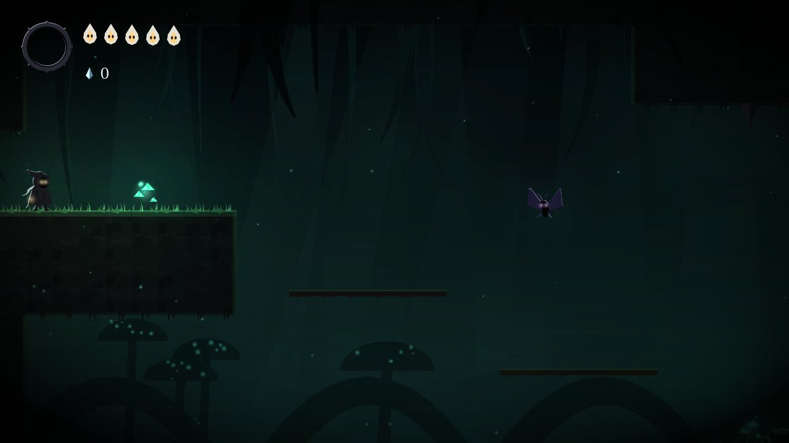
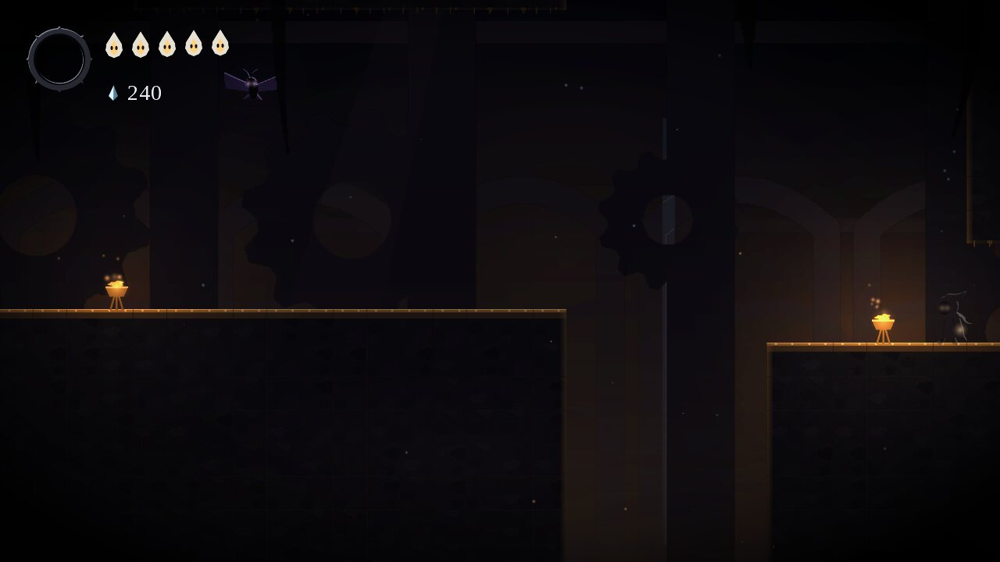
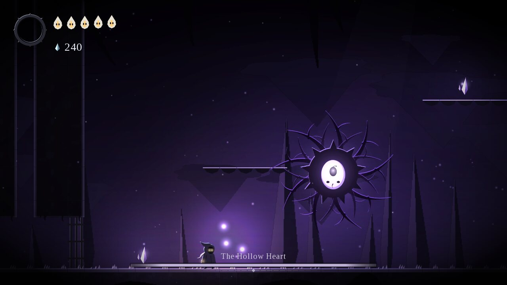
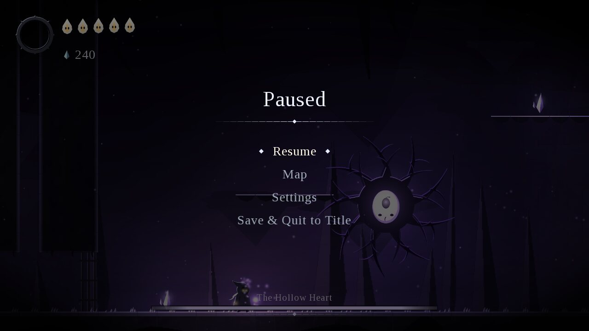
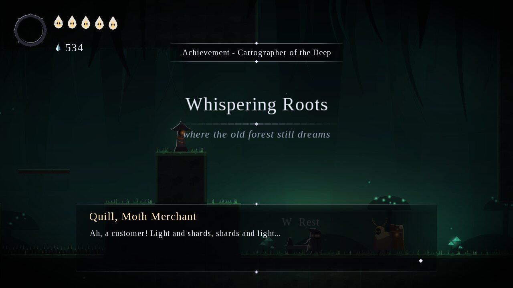
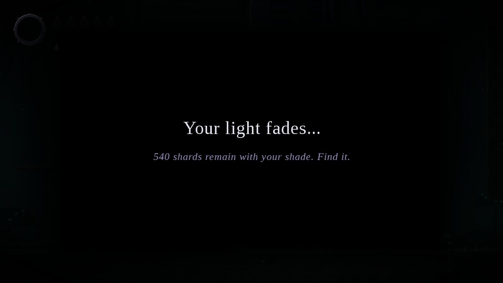
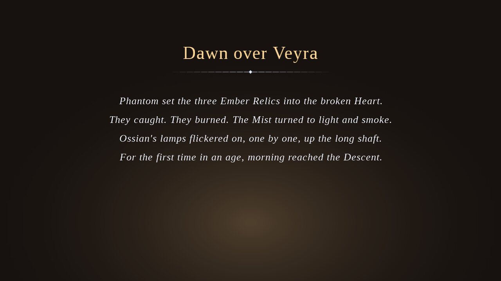

# Test Report

Everything below was actually run in the build environment; the numbers are copied from the
real output. What could **not** be tested there is listed at the end.

## Environment

| Item | Value |
| --- | --- |
| OS | Linux container (no physical display, no sound card, no gamepad) |
| JDK | OpenJDK 21.0.12, compiling with `--release 17` |
| Build | Gradle 8.14.3 through the wrapper (`./gradlew`) |
| Engine | libGDX 1.12.1, LWJGL3 backend, gdx-freetype, gdx-controllers 2.2.3 |
| Display for graphical runs | Xvfb virtual display (1280x720) with Mesa llvmpipe, a **software** OpenGL renderer |

## 1. Build

`./gradlew clean build --warning-mode all` → **BUILD SUCCESSFUL**.
The compiler runs with `-Xlint:unchecked -Xlint:deprecation`; there were **no compiler warnings
and no Gradle deprecation warnings**. `./gradlew eclipse` generates valid Eclipse metadata
(core, desktop, and the `assets` folder linked onto the desktop classpath). `./gradlew sourceZip`
produces `build/distributions/PhantomDescent-source.zip` (269 files, no `build/` folders, no `.class` files).

## 2. Automated tests (JUnit 5): 74 tests, 0 failures, 0 skipped

| Test class | Tests | What it proves |
| --- | --- | --- |
| `systems.CollisionSystemTest` | 6 | Landing on floors, wall and ceiling stops, one-way platforms (pass up, land from above, drop through), ledge probe, out-of-bounds is solid |
| `entities.PlayerPhysicsTest` | 9 | Full jump height matches v²/2g (between 3 and 4 tiles); tapping gives a lower jump; coyote time; jump buffering; 6-tile gap jumpable; 9-tile gap needs the dash; 3-tile ledge yes, 5-tile no; Wisp Leap reaches 6 tiles; wall cling slows the fall and wall jump pushes away |
| `entities.CombatTest` | 6 | Health and invincibility frames; contact damage hits once then i-frames; three slashes kill a crawler, give Light and drop shards; down-slash on spikes bounces without damage; breakable walls crumble after three hits and stay broken in progress; Light Bolt costs soul and hits |
| `abilities.AbilitySetTest` | 4 | Only Focus at start; Dash does nothing until unlocked; Focus turns Light into health; one double jump per airtime |
| `ai.EnemyStateTest` | 6 | State machine timing and enter hook; crawler turns at ledges and never falls off; duskmoth goes IDLE → ALERT → ATTACK; sentinel charges and fires; sentinel ignores a player behind walls; brute charges into a wall and is staggered |
| `entities.BossFightTest` | 1 | Gnarlwarden arena locks, boss wakes after its title card, enters phase 2, dies, gates reopen, Dash is granted, a beaten boss does not return |
| `save.SaveSystemTest` | 7 | Full round trip (abilities, shards, relics, upgrades, bosses, broken walls, discovered rooms, shade, bench, deaths, play time); missing save; corrupted JSON → defaults + message + `save.json.bad`; wrong field types; newer and older versions rejected with clear messages; partial save repaired; settings survive garbage |
| `world.RoomLoaderTest` | 7 | Parsing tiles/markers/doors (row flipping), breakable grouping, invalid JSON, ragged rows, unknown symbols and regions, doors not on an edge, missing world file |
| `world.LevelValidationTest` | 6 | **The shipped world is valid and completable** (see section 3); ≥ 12 rooms (there are 18); Cistern needs Dash; Gearworks needs Moss Grip; Umbral Heart needs Wisp Leap; secrets sit behind breakable walls |
| `sim.GatingTraversalTest` | 5 | Scripted input on the real rooms: a plain jump falls into the Cistern pit but jump + dash clears it; the Drowned Chapel and Gearworks shafts are climbed with Moss Grip all the way to the next room; without it the climb fails; the first Mist Verge ledge is reachable only with Wisp Leap |
| `sim.UmbralTraversalTest` | 2 | Scripted hops across all six Mist Verge ledges and up all seven Hollow Spire ledges, then out through the far doors |
| `sim.HeadlessSimulationTest` | 2 | 6,000 ticks from a new game plus 1,500 ticks in **every** room (33,000 ticks) with pseudo-random move/jump/strike/dash/bolt/focus input: no exception, the player never leaves the map or overlaps a solid tile, particles stay under the cap, fewer than 200 projectile objects are ever created (pooling works) |
| `sim.PerformanceSmokeTest` | 2 | Simulation cost per tick; time to paint all procedural art |
| `art.ProceduralArtTest` | 4 | Polygon fill coverage, downsampling, cut-outs and silhouettes; every painter produces visible sprites; four background layers per region |
| `audio.SoundSynthTest` | 3 | Every sound effect is audible and in range; WAV header is correct; ambient loops have no click at the seam |
| `events.EventBusTest` | 2 | Queued delivery per event type; listeners may unsubscribe and publish while dispatching |
| `util.ObjectPoolTest` | 2 | Pool reuses instances; particle bursts recycle through the pool |

Run them with `./gradlew test` (about 4 seconds).

### Mapping to the required test list

| Required | Covered by |
| --- | --- |
| collision resolution | `CollisionSystemTest` |
| jump physics | `PlayerPhysicsTest` |
| damage and invincibility | `CombatTest`, `AbilitySetTest.focusTurnsLightIntoHealth` |
| ability gating | `AbilitySetTest`, `LevelValidationTest`, `GatingTraversalTest`, `UmbralTraversalTest` |
| enemy state transitions | `EnemyStateTest`, `BossFightTest` |
| save/load round trip | `SaveSystemTest.roundTripKeepsEveryPieceOfProgress` |
| corrupted-save recovery | `SaveSystemTest` (corrupted, wrong types, versions, partial) |
| level validation | `LevelValidationTest`, `RoomLoaderTest` |
| headless simulation | `HeadlessSimulationTest` |

## 3. Level validation

`LevelValidator` reported **no errors**. Starting with only Focus, it reaches Region 1 and the
Gnarlwarden (gaining Dash), then Region 2 and the shrine (Moss Grip) and the Gilded Warden
(Wisp Leap), then all of Region 3 including the final boss. All **18 rooms** are reachable; every
door has a matching door back; no spawn, start point or arrival point is inside a wall; every
boss room has a bench in it or next to it.

Because the validator uses a movement *model*, the real physics of each gate was also played
with scripted input (section 2). This found and fixed two level-design bugs during development:

* The Drowned Chapel shaft could not really be climbed (the validator allowed climbing a single
  wall; real wall jumps push away from the wall). The validator now matches the physics and the
  shaft was reshaped; the scripted climb now reaches the Gearworks Shaft.
* A ceiling chunk in the Mist Verge made full double jumps hit their heads and fall into the mist.
  It was removed; the scripted run now crosses the whole room.

## 4. Bugs found by the tests and fixed

| Bug | Found by | Fix |
| --- | --- | --- |
| Focus never completed: while focusing, gravity was switched off, the collision step stopped reporting "on ground", and Focus cancelled itself next tick | `AbilitySetTest.focusTurnsLightIntoHealth` | Separate `suspendsGravity()` (Dash only) from `controlsMovement()` |
| Husk Brute charge timed out (1.6 s) before reaching a far wall, so it was never staggered | `EnemyStateTest.bruteChargesIntoTheWallAndIsStaggered` | Charge limit raised to 2.4 s |
| Single-wall climbing in the validator but not in the game | `GatingTraversalTest` | See section 3 |
| Mist Verge head-bonk | `UmbralTraversalTest` | See section 3 |

## 5. Graphical runs (virtual display)

A display *was* available through Xvfb with a software OpenGL renderer.

* `./gradlew desktop:run` was started and left running for 40 seconds: it reached the title
  screen, kept running, and logged no errors (it was stopped by the timeout, exit code 124).
  Audio could not open a sound device; the game logged it and continued silently, as designed.
* `./gradlew desktop:tour` (a scripted run through the real game, `ScreenshotTour`) finished
  with exit code 0 and saved 19 screenshots. Confirmed rendering of: the title screen; the HUD
  (masks, soul orb, shard counter); rooms of all three regions with parallax, lighting, particles
  and mist; all three boss fights with their health bars; the pause menu; the map screen; NPC
  dialogue; the shop; the death screen and respawn at a bench; the settings screen; the hidden
  ending.

| | | |
|---|---|---|
|  Title |  Region 1, HUD, bench, NPC |  Region 1 shaft |
|  Region 2 |  Region 2 chapel |  Region 3 |
|  Boss 1 |  Boss 2 |  Final boss |
|  Pause |  Map |  Shop dialogue |
|  Death screen |  Hidden ending | |

Regenerate them with `xvfb-run ./gradlew desktop:tour -PoutDir=<folder>` (or just
`./gradlew desktop:tour` on a desktop).

## 6. Performance

| Measurement | Result |
| --- | --- |
| Game logic, one 1/60 s tick in a busy room (`PerformanceSmokeTest`) | **0.008 to 0.017 ms** (budget: 16.7 ms) |
| Painting all procedural art on the CPU at startup | **0.65 to 1.0 s** (67 sprites, 16 textures) |
| Frame rate under Xvfb + llvmpipe (software rendering on the CPU) | **22 to 25 FPS** in gameplay, 60 FPS on the ending screen |

The software renderer is fill-rate bound (full-screen parallax layers, light map, vignette).
Since the logic costs well under a millisecond per tick, 60 FPS on a real GPU is expected, but
it **could not be measured** here because no GPU was available.

## 7. Not tested in this environment (manual steps below)

* 60 FPS on real graphics hardware.
* Hearing the synthesised audio (no sound device; only the generated data was unit-tested).
* A physical gamepad (the controller backend starts, the mapping code is untested).
* Windows and macOS (only Linux was available), and importing through the Eclipse GUI (only
  `./gradlew eclipse` metadata generation was verified).
* A complete human playthrough from New Game to an ending. Completion is backed by the
  validator, the scripted traversals of every ability gate, the boss-defeat test and the
  long random simulation, but nobody played it end to end by hand.

### Manual test checklist (Eclipse)

1. Import as *Gradle > Existing Gradle Project*; wait for the sync; there should be no red markers.
2. Right-click `core/src/test/java` > *Run As > JUnit Test*: 74 green tests.
3. Run `DesktopLauncher` as a Java Application: the title screen shows "PHANTOM" over drifting
   caves, with spores and soft ambient sound.
4. *New Game*: the tutorial toast appears; walk right, jump the steps, strike the Mosscrawler
   (white flash, sparks, soul orb fills), talk to Ossian (W), rest on the bench (W): "The bench
   remembers you".
5. Press Tab: the map shows the discovered rooms. Press Esc: the pause menu; *Settings* changes
   volume, shake and fullscreen.
6. Let an enemy kill you: "Your light fades...", respawn at the bench, the shade waits where you
   fell; touching it returns the shards.
7. Reach the Gnarled Den: gates close, the boss title card shows, the fight has two phases;
   winning grants Umbral Dash and reopens the gates.
8. Watch the FPS (for example with your GPU overlay): it should hold 60.
